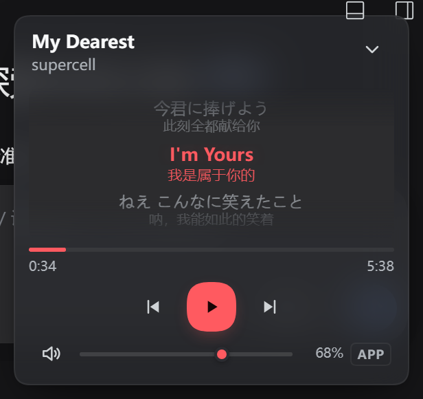

<div align="center">


# dsh-cloudmusic-player

**DSH 里的一块悬浮小播放器，联动你本机的网易云音乐客户端。**

切歌 · 播放暂停 · 拖音量 · 跟着滚的歌词（外语歌带中文译文）

[](LICENSE)
[](package.json)
[](package.json)
[](#要求)



</div>

---

## 它是什么

一块浮在 DSH 界面右下角的小卡片。点开是一个迷你播放器，控制的是**你本来就开着的那个网易云客户端**——不是另起一个播放器，不下载、不登录、不建歌单。

| 能做什么 | 说明 |
|---|---|
| **换歌 / 播放暂停** | 上一首、下一首、播放暂停 |
| **音量** | `APP` 只改网易云自己的音量（不动别的程序，也不动系统总音量）；`SYS` 改系统总音量。两路各自独立读数 |
| **滚动歌词** | 当前行居中高亮、上下淡出；进度连续插值，不是两秒跳一格 |
| **拖进度** | 展开态拖进度条或按 ← / →（±5 s，Shift ±10 s）真的跳转，Home / End 到头尾 |
| **外语歌译文** | 原文下面多一行小字中文，来自网易云自己的翻译 |
| **拖动 / 收起** | 拖到任意位置，位置记在 localStorage；可收成一个只有歌名的小胶囊 |
| **给模型用** | 装好后模型多一个 `cloudmusic_player` 工具，可以替你暂停、切歌、调音量、跳进度、读歌词 |
| **深色 / 浅色** | 跟着 DSH 主题走，对比度按 WCAG AA 调过 |

**它做不到**：不能搜索歌曲、不能改播放列表。

### 进度从哪来

网易云 3.x 在 Windows 10 上**不注册**系统媒体会话（`cloudmusic.dll` 里能直接看到 `[SMTCWrapper] Failed to set play status ret=`），但会把自己的播放事件写进 `%LOCALAPPDATA%\NetEase\CloudMusic\cloudmusic.elog`。插件解码这个日志并回放状态机，拿到曲目、`songId`、时长、**精确到毫秒的播放位置**、暂停/继续、seek。

冷启动解码 8.9 MB / 3 万行只要 **14 ms**，之后每 400 ms 只读新增的尾巴。**不读也不落盘**日志里的 `musicurl`（带签名的播放地址），不需要登录、不碰 cookie。

客户端如果真的注册了 SMTC，就优先走 SMTC。两条都不通就如实说「没在放歌」——**绝不接管别的程序的会话**（早期版本在这里踩过坑：按暂停暂停的是浏览器里的视频）。

### 进度怎么跳

客户端把 `HKLM\SOFTWARE\Classes\orpheus` 注册成 `cloudmusic.exe --webcmd="%1"`，这是它自己的协议入口：`orpheus://<base64(JSON)>`，JSON 是 `{cmd, value}`。第二条 `cloudmusic.exe` 进程会检测到已有实例，把命令转交给主进程后立刻退出；主进程前端 `onWebMessage` 的 `case "seek"` → `playing/setPlayingPosition` → 原生 `DoSeek pos:N`。这是真跳，不是改显示。

代价是**客户端收到任何 orpheus 消息都会 `showWindow`**（前端 `activeWindow` effect 末尾无条件执行，`actionId` 白名单管不到）。所以 `helper.ps1` 里有一整套窗口压制：投递前先把窗口遮起来（最小化/托盘态用空 region + `alpha=0` 的 layered 窗口，可见态用 z 序插回原位），投递后起一个后台守卫盯着，把客户端那几拨迟到的 show 按回去、把焦点还给原来的窗口。实测一次 seek 会引来 2～3 拨 show，最晚一拨落在 7.3 秒，所以守卫要盯满 8 秒以上。

守卫还有个必须的收尾动作：客户端某一拨 show 会把窗口摆在最小化的占位几何（`-25600, 159×27`）却仍然报 `ico=False`，并且顺手把 `rcNormalPosition` 写成那个假几何——不补的话，用户下次还原出来是个 159×27 的小条，所有按钮都点不到。收尾会按到状态真的对了为止，再把 `rcNormalPosition` 写回原矩形。

---

## 装

```bash
# Web / CLI
dsh plugin --profile web add dsh-cloudmusic-player
```

```bash
# dsh 桌面版（dsh-desktop）
dsh plugin --profile desktop add dsh-cloudmusic-player
node scripts/enable-desktop.mjs      # 把包接进桌面 profile（幂等）
```

然后重开 DSH。右下角出现小胶囊，点 ⌃ 展开。

<details>
<summary><b>从源码装 / 本地开发</b></summary>

```bash
git clone https://github.com/jx70/dsh-cloudmusic-player.git
cd dsh-cloudmusic-player
npm install
dsh plugin --profile web add link:"$PWD"     # Windows 上把 $PWD 换成绝对路径 D:/...
```

**开发态和安装态不一样**，值得记住：

| | 源码在哪 | 改代码之后 |
|---|---|---|
| 本地开发（`link:`） | 你的工作目录，profile 里只是个 junction 指过来 | 重载插件就生效 |
| `dsh plugin add`（发行版） | 复制进 `~/.dsh/profiles/<profile>/node_modules/` | 要重新 `add` 一次新版本 |

装好后 DSH 的 profile 里只有两行相关的东西：`package.json` 的 `"dsh-cloudmusic-player": "link:…"`，和 `dsh.profile.bundles` 里的包名。DSH 本体目录里没有副本。

</details>

<details>
<summary><b>在 dsh 桌面版里为什么多一步</b></summary>

桌面版不是另一份代码——是另一个 profile（`--profile desktop`）+ Electron 壳 + `WebContentsView` 加载同一个 Web UI，所以悬浮框、歌词、音量、模型工具全都原样可用，`client.js` 一行都没为桌面版改过。

要多一步是因为桌面版**每次启动都会重写** `profiles/desktop/package.json` 和它的 patch 层（`prepareDesktopProfile()` 里是无条件覆盖），手改活不过一次启动。所以 `scripts/enable-desktop.mjs` 做两件事：建 junction 到包目录；往 `~/.dsh/cordis.patch.yml`（home patch 层，桌面版不覆盖）追加一段带 `!!js` 条件的 insert —— 只在当前 profile 里出现 `@dsh-desktop/client` 时启用，免得 web profile 里也插一份、两边抢同一批路由。

```bash
node scripts/enable-desktop.mjs --check    # 只看状态
node scripts/enable-desktop.mjs --remove   # 卸载
```

另一个原因是宿主版本：桌面版捆绑的 dsh 是 `0.1.0-rc.6`，那代没有 `connection.fetch`，所以插件内置三条传输车道自动挑（`fetch` → `webserver` → `none`）。`/health` 的 `transport` 字段会告诉你走的哪条。

</details>

### 要求

| | |
|---|---|
| 系统 | Windows 10 1809 以上 |
| PowerShell | **5.1**（`powershell.exe`）。PowerShell 7 没有 WinRT 投影，播放控制会不可用 |
| 客户端 | 网易云音乐桌面版（注册不注册 SMTC 都能用） |
| DSH | ≥ **0.1.0-rc.6**，Node ≥ 22。Web / CLI / 桌面版都行 |

macOS / Linux 上插件照样能装：悬浮框和歌词都在，只是播放控制与音量会显示「本机不支持」（后端是插拔式的，见 [`docs/DESIGN.md`](docs/DESIGN.md#移植到-macos--linux)）。

---

## 用

- **拖动**：按住卡片顶部空白处（或收起态的胶囊）拖到任意位置。
- **收起**：右上角 ⌃ → 变成只有歌名的小胶囊，再点 ⌃ 展开。
- **音量**：拖滑块，松手后 110 ms 内的连续拖动会合并成一次请求。`APP` / `SYS` 切换作用域，滑块与百分比始终显示**当前作用域那一路**。
- **歌词**：有 `songId` 时直取（最准），否则按「歌名 + 歌手 + 时长」搜索。`作词/作曲/编曲/制作人` 这类署名行照常显示（更淡）但不参与高亮——否则歌前那十几秒高亮会钉在「制作人」上不动，看着像卡死。
- **外语歌译文**：网易云的 `tlyric` 与 `lrc` 同格式，按时间戳逐行叠起来（精确相等直接配，少量不齐用 ≤60 ms 最近邻，宁缺不错）。中文歌的 `tlyric` 本来就是空的，所以不用判语种。关掉：`lyricsTranslation: false`。
- **拖动进度**：拖进度条，或把焦点放到进度条上按 ← / →（±5 s，Shift ±10 s）、Home / End 到头尾。松手才发一次命令，中间是跟手的视觉插值。
- **歌词对不上时**：点歌词里当前那一句，就把那行的 LRC 时间戳当作「现在播到这里」（兜底路径，只在日志读不到时出现；锚点按歌记 30 分钟）。

---

## 配置

`~/.dsh/profiles/<profile>/cordis.patch.yml` 里覆盖：

```yaml
- insert:
    - id: cloudmusic-player
      name: dsh-cloudmusic-player
      config:
        processName: cloudmusic          # 进程名，不含 .exe
        aumidPattern: 'cloudmusic|netease|wangyi'
        volumeScope: process             # process | system
        lyricsEnabled: true
        lyricsTranslation: true          # 外语歌叠中文译文
        lyricsOffsetMs: 0                # 歌词整体提前/推后（毫秒）
        powershellPath: powershell.exe   # 别填 pwsh.exe
        hotkeyPlayPause: 'Ctrl+Alt+P'    # 要和客户端「设置 → 快捷键」里一致
        hotkeyNext: 'Ctrl+Alt+Right'
        hotkeyPrev: 'Ctrl+Alt+Left'
        elogEnabled: true                # 读客户端日志拿真进度
        elogPath: ''                     # 留空 = 自动找
        elogPollMs: 400
```

其余（`lyricsApiBase` / `requestTimeoutMs` / `restartLimit`）见 [`docs/DESIGN.md`](docs/DESIGN.md#配置全表)。

标了 `.volatile()` 的几项（`volumeScope` / `lyricsEnabled` / `lyricsTranslation` / `lyricsOffsetMs` / `requestTimeoutMs` / `restartLimit` / `elogEnabled` / `elogPollMs`）改完**即时生效**，不用重载。

---

## 排错

先看自检端点，它是唯一权威：

```
http://127.0.0.1:3080/api/cloudmusic-player/health?deep=1
```

（桌面版换成它的随机端口。）

| 现象 | 先看什么 |
|---|---|
| 显示「没在放歌」 | 网易云真在放吗？`pids` 空 = `processName` 不对 |
| 按暂停暂停的是别的程序 | 不该发生了。看 `media[].aumid` 是不是被写进了 `aumidPattern` |
| 切歌没反应 | `hotkeyNext` / `hotkeyPrev` 和客户端的全局快捷键不一致 |
| 进度条不出现 | `elog.available: false` → 看 `elog.reason`（`missing` / `no-track-yet` / `client-exited`） |
| 拖了进度没反应 | 看 `/action` 的返回：`ok: false` 说明 `orpheus` 协议没注册（`reg query HKLM\SOFTWARE\Classes\orpheus`）；`channel: smtc` 说明走的不是这条路 |
| 跳进度时客户端闪一下 | 正常：客户端收到协议消息必弹窗，helper 会把它按回去。托盘态一帧不露，最小化态只在屏外动，可见态位置不动 |
| 跳完进度顶部一条白边 | 客户端那 4 个 `OrpheusShadow` 边框窗被排到了主窗口上面。清一次它们的 region 即可（helper 在投递前会自动做），若反复出现说明 helper 是旧版本 |
| 显示「后台没响应」 | 点重试；还不行看 `stderr` 字段，或 `transport` 是不是 `none` |
| 音量拖了没反应 | `pids` 空（没匹配到进程）；或 SYS 作用域下系统端点被独占 |
| 外语歌没有小字译文 | `lyricsTranslation` 是不是关了；中文歌本来没有；也可能这首就没翻译 |
| 桌面版里报错 | `node scripts/enable-desktop.mjs --check`，跑完记得重启 dsh-desktop |

完整排错表（含 403、`webserver: duplicate exact route`、`!!js` 求值等）在 [`docs/DESIGN.md`](docs/DESIGN.md#排错完整)。

---

## 已知限制

1. **不登录、不搜索、不建歌单**——只控制「已经在放的那首」。
2. **跳进度会起一个短命的 `cloudmusic.exe`**。协议命令要走客户端自己的 `--webcmd` 入口，第二个进程把消息转交主进程后约 1 秒内自行退出（日志里是 `Another client is exist.`）。松手才发一次，不是连续发。
3. **跳进度时会短暂压制客户端窗口**。客户端收到消息必弹窗（协议行为），所以投递前后要遮窗口、盯 z 序、还焦点。托盘态一帧不露，最小化态只在屏外动，可见态位置不动。
4. **进度依赖客户端日志**。日志读不到（旧版客户端 / 被关 / 路径不同）时降级为「本地计时 + 点歌词校准」——那时起点是猜的（滞后量 = 打开前已播的时长）。
5. **播放暂停是切换键**。为防「按暂停反而开始播」，发键前先看 2.6 秒内的意图缓存，没有才采 ~150 ms 峰值判定。极静的段落仍可能误判。
6. **只有 Windows 有真实后端**，且必须 PowerShell 5.1。
7. 歌词与译文都来自网易云的 web 接口（非公开），可能限流或改字段；译文翻错、翻得少是数据源的事，插件不补译。

完整的 18 条（含版权曲目匹配、日志编码版本依赖、旧世代宿主鉴权水位等）在 [`docs/DESIGN.md`](docs/DESIGN.md#已知限制完整)。

---

## 开发

```bash
npm test                      # 77 条：日志解码 31 + 歌词 25 + 传输层 21
node --test test/elog.test.mjs   # 单个文件（目录形式会 Cannot find module）
npm run enable-desktop        # = node scripts/enable-desktop.mjs
npm run sync                  # 推 GitHub
```

测试不碰系统、不需要开着网易云：解码器与状态机用合成日志，歌词用打桩的 `fetch`，传输层用假的 `connection` / `webServer`。

```
index.js             Host 半端：Config / 6 条路由 / 模型工具
client.js            Client 半端：shell.overlay 槽里的悬浮框
lib/player.mjs       助手进程生命周期 + 三车道合并
lib/helper.ps1       常驻 PowerShell（WinRT / Core Audio / 窗口标题 / 热键）
lib/elog.mjs         cloudmusic.elog 解码 + 状态机回放
lib/lyrics.mjs       搜索匹配 / LRC 解析 / 译文叠加
lib/cache.mjs        歌词磁盘缓存（30 天）
lib/transport.mjs    三条传输车道 + Fetch↔Node 适配
lib/backend.mjs      平台后端注册表
docs/DESIGN.md       实现层的完整说明
```

想改实现先读 [`docs/DESIGN.md`](docs/DESIGN.md)——那里记着 `GetSimpleAudioVolume` 的第二个参数不是 pid、`SetMute` 的 bool 必须显式封送、为什么传输层要三条车道这些坑，能省你半天。

---

## License

[MIT](LICENSE)
