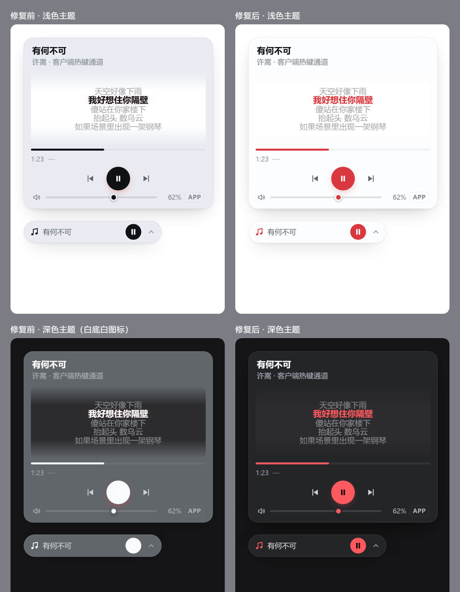

# 设计说明

README 只讲「怎么装、怎么用」。这份文档讲**为什么这么写** —— 每个不太显然的决定、踩过的坑、以及验证过的数字。
出问题时先看这里，再看 `README.md` 的排错表。

- [整体架构](#整体架构)
- [两条控制车道](#两条控制车道)
- [进度从哪来：cloudmusic.elog](#进度从哪来cloudmusicelog)
- [为什么助手进程要常驻](#为什么助手进程要常驻)
- [音量：Core Audio 的两个坑](#音量core-audio-的两个坑)
- [传输车道：为什么不是一条路走到黑](#传输车道为什么不是一条路走到黑)
- [不依赖 @deepseek-ai/dsh-*](#不依赖-deepseek-aidsh-)
- [HTTP 接口](#http-接口)
- [模型工具](#模型工具)
- [主题与配色](#主题与配色)
- [移植到 macOS / Linux](#移植到-macos--linux)
- [配置全表](#配置全表)
- [自检：health?deep=1](#自检healthdeep1)
- [已知限制（完整）](#已知限制完整)
- [排错（完整）](#排错完整)

---

## 整体架构

```
┌──────────────── DSH Host 进程 ────────────────┐
│  index.js                                     │
│    ├─ PlayerService ── spawn ──► powershell.exe (常驻)
│    │    │                         └─ lib/helper.ps1
│    │    │                              ├─ SMTC (WinRT)   → 歌名/进度/控制（车道 1）
│    │    │                              ├─ 窗口标题 + 峰值 → 兜底歌名/播放态（车道 2 降级）
│    │    │                              ├─ keybd_event     → 全局热键控制（车道 2）
│    │    │                              └─ Core Audio      → 音量（按 pid）
│    │    └─ ElogWatcher ── 读 ──► cloudmusic.elog
│    │                               └─ 解码 + 回放 → 曲目/songId/时长/位置/暂停（车道 2）
│    ├─ LyricsService ── fetch ──► music.163.com
│    └─ 6 条 /api/cloudmusic-player/* 路由
└───────────────────────────────────────────────┘
                    ▲ 同源 fetch（带 cookie，过 connection 信任栅栏）
┌──────────────── 浏览器 ───────────────────────┐
│  client.js → shell.overlay 槽 → 悬浮框         │
└───────────────────────────────────────────────┘
```

`lib/elog.mjs` 是独立模块，不依赖 PowerShell 助手 —— 助手起不来时曲目和进度照样准，
只是控制（播放/暂停/切歌）和音量用不了。反过来助手能起来但日志读不到时，进度退回本地计时。

文件职责：

| 文件 | 职责 |
|---|---|
| `index.js` | Host 半端：Config、6 条路由、模型工具、把服务接起来 |
| `client.js` | Client 半端：`shell.overlay` 槽里的悬浮框，自注册脚本（非 ESM） |
| `lib/player.mjs` | 助手进程的生命周期 + 请求/响应配对 + 三车道合并 |
| `lib/helper.ps1` | 常驻 PowerShell：WinRT、Core Audio、窗口标题、热键，JSONL 协议 |
| `lib/elog.mjs` | `cloudmusic.elog` 解码 + 状态机回放 |
| `lib/lyrics.mjs` | 搜索匹配、LRC 解析、译文叠加 |
| `lib/cache.mjs` | 歌词磁盘缓存（30 天 / 400 个文件上限） |
| `lib/transport.mjs` | 三条传输车道的选择与 Fetch↔Node 适配 |
| `lib/backend.mjs` | 平台后端注册表（Windows 一个对象，非 Windows 一个降级对象） |

---

## 两条控制车道

| 车道 | 用在什么时候 | 歌名/歌手 | 进度 | 控制 |
|---|---|---|---|---|
| **系统媒体会话（SMTC）** | 客户端正确注册了系统媒体控制 | WinRT 会话属性 | 会话时间轴，可 seek | WinRT 控制 |
| **客户端日志（native）** | 客户端没注册 SMTC，或注册失败（网易云 3.x 的常态） | `cloudmusic.elog` 里的曲目事件 | `cloudmusic.elog` 回放，精确到毫秒 | 客户端全局热键（`Ctrl+Alt+P` 等） |

native 车道里，窗口标题 + 音频峰值仍然在，但只作**兜底**：日志读不到（旧版客户端、日志被关、
日志还没写入第一条事件）时，才回落到「窗口标题取歌名 + 峰值判播放态 + 没有进度」。

### 实测背景

网易云桌面版 on Windows 10 19041 会在启动时尝试注册 SMTC 并**失败** ——
`cloudmusic.dll` 里能直接搜到 `[SMTCWrapper] Failed to set play status ret=` /
`Failed to set play info ret=` / `Failed to set thumbnail ret=`，上下文路径是
`orpheus\src\framework\plugin\player\player.cpp`。所以系统里只看得见浏览器之类的会话。

早期版本因此踩了个坑：会话挑选逻辑里有一条「系统里只有一个媒体会话就用它」的兜底，
于是它把 Edge 里正在播的 B 站视频当成了网易云 —— **按暂停暂停的是网页视频**。
现在这条兜底已经删掉，只认 AUMID 正则或进程名命中，无命中就如实报「没有可控制的会话」，
两条车道都不通就显示「没在放歌」。**绝不接管别人的会话。**

### native 车道的播放/暂停是切换键

`Ctrl+Alt+P` 是一个键来回切，没有独立的「播放」和「暂停」指令。所以插件不能盲目按键。

问题在于判断「现在到底在不在放」：客户端暂停后有约 **900 ms 的淡出**（实测
`0.1620 → 0.1047 → 0.1358 → 0.0368 → 0.0281 → 0.0097 → 0`），恢复后有约 1 s 的淡入
（`0.0048 → 0.0089 → 0.0253 → 0.1053 → 0.1996 → 0.2532`）。这段时间峰值还像在播。

所以发键前先看**意图缓存**：`player.mjs` 在发命令前把日志回放出的真实 `playing` 灌给助手
（`{"cmd":"intent","playing":false}`），助手优先信它，2.6 秒内有效。没有意图才采 ~150 ms 峰值判定。
有了这层，连点两次暂停不会把歌放回来，连点两次播放也不会又暂停。

发键前**不抢前台焦点** —— 全局热键不需要焦点，`SetForegroundWindow` 反而会打断你正在做的事。

没有采用 `VK_MEDIA_PLAY_PAUSE`（键盘上的媒体键）：它会同时暂停浏览器里正在放的东西。

### 歌名从窗口标题来（兜底路径）

切歌瞬间客户端会冒出 `GDI+ Window (cloudmusic.exe)` 这种比歌名更长的调试窗口名。
所以不能只取最长文本，要按特征打分：

- 含 ` - ` **+1000**
- `IsWindowVisible` **+200**
- 类名 `Orpheus*` **+400**、`Chrome_WidgetWin*` **+300**
- 基础分 = 文本长度
- 直接淘汰：含 `.exe`、以 `GDI+` / `Window (` / `Default IME` / `MSCTFIME` 开头、等于 `桌面歌词` / `迷你播放器` / `CloudMusic`

拿到后再按**最后一个** ` - ` 切成歌名/歌手（歌名本身含 ` - ` 时按最后一个是唯一稳妥的切法）。

---

## 进度从哪来：cloudmusic.elog

网易云 3.x 不注册 SMTC，不给你时间轴，也不开任何可用的 IPC —— 但它自己往
`%LOCALAPPDATA%\NetEase\CloudMusic\cloudmusic.elog` 里写播放事件。

日志是**逐字节替换**的弱加密：

```js
const DECODE_TABLE = new Uint8Array(256)
for (let b = 0; b < 256; b++) {
  const high = b >> 4, low = b & 0x0f
  const hex = ((high ^ ((low + 8) % 16)) % 16) | 0
  DECODE_TABLE[b] = (hex * 16 + (b >> 6) * 4 + ((~high) & 3)) & 0xff
}
```

反表由解码表反推，换行字节 `ENCODED_NEWLINE` 也是算出来的（本机实测 `145` / `0x91`），
**不硬编码**。

### 事件与状态机

日志行头部是 `[pid:tid:MMDD/HHMMSS:uptimeMs:LEVEL:file.cpp(line)] [墙钟时间] 【频道】...`。
`uptimeMs` 配合 `os.uptime()` 换算事件时刻；与墙上时钟差 > 5 秒时改用墙钟（防休眠漂移）。

| 事件 | 触发 | 状态机动作 |
|---|---|---|
| `"playOneTrackInPlayingList"` | 点了某首歌 | 换曲，占位 `songId` |
| `"checkPlayPrivilege"` | 起播前的权限检查 | 补全曲目详情，`pausing = true` |
| `native播放资源load完成，开始播放` | 真正起播 | **重锚**（比 track 事件准） |
| `"native播放state", N` | 播放状态变化 | `N === 2` 暂停；切换前先用当前位置结算锚点 |
| `"setPlayingPosition", S` | 拖动进度条 | 锚点直接设到 `S * 1000` |
| `onPlayEnd handle reason` | 播完 | 锚点设到时长，`pausing = true` |
| `exitApp` / `Process N exited` | 客户端退出 | 清空状态，`reason = 'client-exited'` |

`native播放资源开始load` 是另一条事件，**不算起播** —— 它与「load完成，开始播放」成对出现，
只认后者才能避免进度提前一个缓冲的时间。

`playOneTrackInPlayingList` 与 `checkPlayPrivilege` 会连发，同一首歌在 1500 ms 内的重复出现
视为同一次起播，不重置锚点。

### 边界处理

| 情况 | 做法 |
|---|---|
| 日志不存在 / 客户端 2.x | `available: false`，降级为本地计时 |
| 文件轮转（size 变小于 offset） | 清零重预载 |
| 读到半个行 | 按**字节**保留 carry（不按字符，否则会把 UTF-8 汉字劈坏） |
| 位置越界（超时长 5 秒） | 夹到 `duration`，视为播完 |
| 上次运行的残留事件 | `exitApp` / `Process N exited` 带 pid，与运行中的 cloudmusic pid 比对 |
| `songId` 先到、详情后到 | 先占位，等 `checkPlayPrivilege` 补全 |

### 性能

冷启动解码 8.9 MB / 3 万行实测 **14–15 ms**。之后每 400 ms 只读新增的尾巴。

预载不读整个文件：从**尾部**按 1 MB 块向前扫，最多 16 MB，找到最近一条曲目事件就停 ——
日志长到几百 MB 也不会让它变慢。（朴素写法是整文件全量读，长期跑会越来越慢，所以这里绕开了。）

只读事件行，**不读也不落盘**日志里的 `musicurl`（那是带签名的播放地址），
不需要登录、不碰 cookie。

---

## 为什么助手进程要常驻

每次操作重新起 PowerShell，都要重新加载 WinRT 投影、重新 `Add-Type` 编译 C# 接口声明 ——
单次 **300ms 以上**。常驻之后实测：

| 操作 | 首次（冷启动） | 之后 |
|---|---|---|
| 启动 + 加载 WinRT | 399–660 ms | — |
| `state`（SMTC 车道） | 93–110 ms | 7–25 ms |
| `state`（native 车道，日志 + 窗口标题 + 峰值采样） | 259 ms | 110–145 ms |
| `ping` | — | ~0 ms |
| 调音量（按进程） | — | 6–12 ms |
| `deep`（自检） | — | 48–101 ms |
| 日志冷解码（8.9 MB / 3 万行） | 14–15 ms | 每 400 ms 只读增量 |

悬浮框两秒轮询一次，差别直接体现成「拖音量跟不跟手」。

协议是 stdin/stdout 上的 JSONL：

```
→ {"seq":1,"cmd":"state"}
← {"type":"reply","seq":1,"ok":true,"cmd":"state","now":{...},"volume":{...},"sessions":[...]}
```

`seq` 配对而不是「发一条收一条」，因为 ready 之后的回复可能乱序。

### PowerShell 的硬性要求

- **必须 `powershell.exe`（5.1）**，不能是 `pwsh.exe`（7）：PowerShell 7 没有 WinRT 投影，
  `AsTask` 桥接不可用，SMTC 整个失效（`winrt: false`）。
- **`lib/helper.ps1` 必须是 UTF-8 **带 BOM** + LF**。PowerShell 5.1 对无 BOM 的 UTF-8
  文件按 ANSI 解码，中文注释会变成乱码，然后报
  `类、结构或接口成员声明中的标记“{”无效` —— 一个完全指不到真正原因的错。
  仓库的 `.gitattributes` 就是为了防止 `core.autocrlf` 改坏这两点。

---

## 音量：Core Audio 的两个坑

### 坑 1：`GetSimpleAudioVolume` 的第二个参数不是 pid

```csharp
// 错的
void GetSimpleAudioVolume(ref Guid guidEventContext, int dwSessionId, out ISimpleAudioVolume vol);
```

名字骗人：第二个参数是**音频会话 ID**（DWORD），不是进程 ID。传 pid 进去，拿到的是
「调用进程自己的默认会话」—— 结果是改一次音量，任务栏音量合成器里**所有程序**都跟着变。

正确做法：

```
GetSessionEnumerator
  → GetSession(i, out IAudioSessionControl c)
  → (c as IAudioSessionControl2).GetProcessId(out pid)   匹配目标
  → c as ISimpleAudioVolume                              （同一个 COM 对象 QueryInterface）
```

`IAudioSessionControl` 的 IID 必须是 `F4B1A599-7266-4319-A8CA-E70ACB11E8CD`
（填错成 `24918AA1-…` 会编译通过、运行时 `E_NOINTERFACE (0x80004002)`）。

`IAudioSessionManager2` 的 vtable **不能加 NotImplemented 占位**，否则 `GetSessionEnumerator`
直接 `System.AccessViolationException` 崩进程（不是返回错误，是崩）。

### 坑 2：`SetMute` 的 bool 必须显式封送

```csharp
int SetMute([MarshalAs(UnmanagedType.Bool)] bool bMute, ref Guid guidEventContext);
```

不写 `[MarshalAs(UnmanagedType.Bool)]` 时 COM 默认按 2 字节 `VARIANT_BOOL` 封送，
槽位错位 → `SetMute(true)` 抛异常 → 被 `catch { Reset(); return false; }` 吞掉 →
表现为「点了静音没反应」，而且没有任何日志。加上之后两条路径（`IAudioEndpointVolume`
与 `ISimpleAudioVolume`）的 `SetMute` / `GetMute` HRESULT 全是 `0x0`。

### 两路读数必须分开

服务端原来只回一路，且恒为「APP 优先」（`Get-Volume` 先找网易云的音频会话，找不到才退系统端点）。
于是写系统端点时回读的仍是 APP 那一路 —— 真机上系统端点 36%、APP 49%，拖到 70% 后
界面上立刻显示回 49%，看起来就是「拖完弹回原值」。

现在 `/state` 与 `/volume` 同时返回 `volume`（APP）与 `systemVolume`（SYS），
写入后回读**实际写的那一路**（`Get-VolumeAt $applied`），前端用 `scopeNow` / `activeVol`
决定滑块、百分比、静音图标、`SYS`/`APP` 标签看哪一路。同一根因下 `SYS` 作用域的静音键
以前切的是 APP 那一路，也一并修好。

### 客户端自己的音量滑块是另一回事

网易云 UI 里那个音量滑块是**应用内部增益**，不写音频会话音量、不写系统端点、也不写任何
可读配置（`%LOCALAPPDATA%\NetEase` 全树快照、`webdb.dat` 91 MB 扫描、注册表、
命名管道、`127.0.0.1:20017` 端口全查过，0 命中）。它只能通过 `Ctrl+Alt+↑/↓` 步进（约 2 dB/档），
步进效果会体现在 `IAudioMeterInformation` 峰值上。

它和音频会话音量是**相乘**关系，互不干扰。插件控制的是会话音量（Windows 层面那个），
不是客户端内部增益 —— 这一点在 UI 上没有假装能控它。

---

## 传输车道：为什么不是一条路走到黑

新版 dsh（≥ 0.1.5-rc.1）里，整个 `/api` 前缀挂在 connection 的信任栅栏后面，栅栏里的 `admit()`
要求请求带浏览器 cookie（或 API token），否则一律 401。`connection.fetch.register` 注册在栅栏
**内部**，按 pathname 精确分发、要求 principal 是 owner —— 正好是「页面自己 fetch 自己」的场景。
自己 `webServer.register('/api/...')` 会被外层前缀路由先吃掉，永远走不到。所以**首选**永远是它。

但 `connection.fetch` 不是一开始就有：

| 版本 | `registerFetchRoute` | `get fetch()` |
|---|---|---|
| 0.1.0-rc.6 / rc.7 / rc.8 | 0 | 0 |
| 0.1.1-rc.1 | 0 | 0 |
| **0.1.5-rc.1** | 2 | 1 |
| 0.1.7-rc.1 / 0.2.0-rc.1 | 2 | 1 |

而 **dsh-desktop 捆绑的正是 `0.1.0-rc.6`**（Electron 43 + Node 24.19 + `@deepseek-ai/dsh@0.1.0-rc.6`）。
那种宿主上唯一能用的通道是 `ctx.webServer.register({ kind:'exact' })` —— 它在两代里签名完全一致，
`match()` 都是「先 exact 表、再最长前缀」，所以自己注册的精确路径会先于 connection 的 `/api`
前缀命中，也不会把整个 `/api` 抢走。

三条车道：

| 车道 | 条件 | 鉴权 |
|---|---|---|
| `fetch` | `connection.fetch.register` 存在（dsh ≥ 0.1.5-rc.1） | 宿主的 owner-peer 鉴权（cookie） |
| `webserver` | 否则，`webServer.register` 存在（rc.6 及更早） | 插件自带的回环/同源栅栏 + 可选委托宿主 `requestRejection` |
| `none` | 两者都没有 | 只记日志，其余功能照常 |

绕过 connection 就没了 cookie 鉴权，所以旧车道上补了三层栅栏：

1. **自校验永远先跑** —— Host 必须回环（`localhost` / `*.localhost` / `127.0.0.0/8` 逐段校验，
   防 `127.0.0.1.evil.com` 这类相似域名、`[::1]` 也认），或用 `DSH_TRUSTED_HOSTS` 显式声明；
   `Sec-Fetch-Site: cross-site` 一律 403；带 `Origin` 时必须与 Host 同源。
2. 宿主的 `connection.requestRejection` 可用就**委托**它（里面还有浏览器鉴权那一层），
   返回码照用，**它抛异常按拒绝处理** —— 旧实现是 fail-open，这里不跟。
3. 都没有 → 只靠第 1 条，并在挂载时打一条醒目 warn。

`/health` 会告诉你它挑到了哪条：`{"transport":"fetch","transportNote":"connection.fetch"}`。

开自定义端口则要多一套鉴权 + CORS，没必要。

`toNodeHandler` 里还有几个细节：64 KiB body 上限（超限 413）、方法闸（405 + `allow` 头）、
异常兜底成 500 且不泄栈、注册前自愈残留的同名路由（上一次 `apply` 没清干净时）。

### dsh 桌面版（dsh-desktop）为什么需要单独的安装脚本

桌面版不是另一份代码 —— 是另一个 profile（`--profile desktop`）+ Electron 壳 +
`WebContentsView` 加载同一个 Web UI。所以悬浮框、歌词、音量、模型工具全都原样可用，
`client.js` 一行都没为桌面版改过。

真正需要适配的是两件事：**传输层**（上面那三条车道）和**安装方式**。

`prepareDesktopProfile()`（`src/main/first-run.ts`）**每次启动**都无条件
`writeFileSync` 重写 `profiles/desktop/package.json` 与 `profiles/desktop/cordis.patch.yml`，
没有任何 exists 判断 —— 手改的东西下一次启动就没了。所以：

1. **junction** 建在 `profiles/desktop/node_modules/dsh-cloudmusic-player`：
   `installPlugin()` 的 `copyPluginLib()` 只写 `@dsh-desktop/client` 那一个目录，不清理邻居，
   所以 junction 能活下来。
2. **插件行**写进 `<DSH_HOME>/cordis.patch.yml`（home patch 层）。这层叠在 profile patch **之上**，
   桌面版不会覆盖它。条目带条件 `disabled`：

   ```yaml
   disabled: !!js "!ctx.loader.entries().some((e) => e.options.name === '@dsh-desktop/client')"
   ```

   只有当加载树里存在 `@dsh-desktop/client`（也就是当前是桌面 profile）时才启用。
   否则 web profile 也会再插一个实例，两条车道去注册同一批 exact 路径，
   宿主直接抛 `webserver: duplicate exact route`。

   这个表达式能成立是因为 loader 求值方式是
   `new Function("ctx", "expr", "with (ctx) { return eval(expr) }")`，而 `ctx.loader` 由 loader 自己
   `ctx.reflect.provide("loader", this)` 提供；`entries()` 产出的 entry 上有 `options.name`。

---

## 不依赖 @deepseek-ai/dsh-*

`index.js` 只 import `@deepseek-ai/schemastery`（Config 的 schema 语法）。工具、路由全用标准 JS 对象描述。

这样插件在任何 profile 里都能加载 —— 不会因为宿主树解析不到某个内部包，整个 bundle 直接挂掉。
（生态里踩过这个的不少：bundle 里 import 了一个只在特定 profile 里装了的 `@deepseek-ai/dsh-*`，
换 profile 就 `ERR_MODULE_NOT_FOUND`。）

`client.js` 只 `require('react')`。样式用 `document.createElement('style')` 自己插，
位置用 `ctx.effect(() => () => style.remove(), ...)` 挂在插件生命周期上。

---

## HTTP 接口

6 条，全部同源、要浏览器 cookie（`fetch` 车道）或过自校验栅栏（`webserver` 车道）：

| 方法 | 路径 | 说明 |
|---|---|---|
| GET | `/api/cloudmusic-player/state` | 当前状态（歌名/歌手/进度/音量/会话） |
| POST | `/api/cloudmusic-player/action` | `{ "action": "play\|pause\|toggle\|next\|prev\|seek", "positionMs": 0 }` |
| POST | `/api/cloudmusic-player/volume` | `{ "level": 0.5 }` 或 `{ "muted": true }`，可带 `"scope": "process\|system"` |
| GET | `/api/cloudmusic-player/lyrics?songId=&title=&artist=&durationMs=` | LRC 解析后的 `lines: [{t, text, tr?}]`，顶层带 `translated`（有译文为 true）；给了 `songId` 就直取，跳过搜索 |
| GET | `/api/cloudmusic-player/health[?deep=1]` | 自检；`deep=1` 列出全部 SMTC 会话与音频会话；带 `transport`（`fetch` / `webserver` / `none`）说明走哪条车道 |
| POST | `/api/cloudmusic-player/restart` | 重启助手进程（清掉「放弃重启」状态） |

失败一律 `{ ok: false, error, detail }`，**不返回 500** —— 悬浮框要能稳定显示错误，而不是白屏。

业务失败的 `error` 取值：`no-session`（没有可控制的会话）、`seek-unsupported`（native 车道不能 seek）、
`bad-action`（未知动作）、`helper-unavailable`（助手起不来）、`lyrics-disabled`（歌词被关了）。

---

## 模型工具

装好之后模型多一个 `cloudmusic_player`：

```
action: status | play | pause | toggle | next | prev | seek | volume | mute | lyrics | health
positionMs / level / muted / scope
```

「放首歌」它做不了（那要登录态搜索 + 播放列表），它能做的是**接管你正在放的那首**。

`status` 的输出会写清「歌词来源」「进度来源」，`health` 会列出窗口通道、原生车道、热键、
日志车道、HTTP 车道 —— 都是给模型看的诊断事实，不上界面。

---

## 主题与配色

悬浮框跟着宿主的浅色/深色主题走（`body[data-ds-dark-theme]`，宿主是通过
`document.body.toggleAttribute('data-ds-dark-theme', dark)` 切的，所以选择器必须从 `body` 起）。

强调色是插件自己的变量（`--nc-accent` 等），**不借用 `--dsw-alias-brand-primary`** ——
那个 token 在设计系统里是**前景墨色**而不是品牌色（浅色 `#0f1115`、深色 `#f9fafb`），
拿它当实心按钮底色，深色下就是 `#f9fafb` 底 + `#fff` 图标，整个按钮糊成一个白块，
全靠外发光才勉强看出是个圆。

| | 浅色 | 深色 |
|---|---|---|
| 主按钮底色 | `#d9383f` | `#ff5a60` |
| 图标色 | `#ffffff` | `#1a0506` |
| 对比度 | 4.58 : 1 | 6.44 : 1 |
| 卡片面层 | `rgba(252,253,254,.88)` | `#2b2c31b8` |

对比度是按 WCAG 手算的（卡片面层先按 alpha 合成到页面底色再算）。历史值：浅色用 `#e5484d`
时白图标只有 3.91:1（不到 AA 的 4.5:1），深色下原来的「白底白图标」更是只有 **1.05:1**。



---

## 移植到 macOS / Linux

`lib/backend.mjs` 里加一个对象即可，`player.mjs` / `index.js` / `client.js` 一行都不用改：

```js
export const macBackend = {
  id: 'macos-mediaremote',
  platform: 'darwin',
  capabilities: { playback: true, sessionVolume: false, systemVolume: true, lyrics: true },
  command(cfg) { return { shell: 'node', args: ['lib/mac-helper.mjs'] } },  // 同样 JSONL 协议
}
```

要求的协议就三件事：

1. 起来之后往 stdout 打一行 `{"type":"ready","winrt":false,"audio":true,"ps":"..."}`
2. 每读一行 stdin（`{"seq":N,"cmd":"...","...":...}`），往 stdout 回一行 `{"type":"reply","seq":N,"ok":true,...}`
3. 收到 `{"cmd":"quit"}` 就退出

mac 上大概会用 `MediaRemote`（`nowplaying-cli`）+ `osascript -e 'set volume output volume N'`；
Linux 上是 `playerctl` + `pactl`。

---

## 配置全表

`~/.dsh/profiles/<profile>/cordis.patch.yml` 里覆盖：

```yaml
- insert:
    - id: cloudmusic-player
      name: dsh-cloudmusic-player
      config:
        processName: cloudmusic          # ← 进程名，不含 .exe
        aumidPattern: 'cloudmusic|netease|wangyi'
        volumeScope: process             # process | system
        lyricsEnabled: true
        lyricsTranslation: true          # 外语歌叠中文译文（中文歌本来就没译文）
        lyricsApiBase: 'https://music.163.com/api'
        lyricsOffsetMs: 0                # 歌词整体提前/推后（毫秒）
        powershellPath: powershell.exe   # 别填 pwsh.exe
        requestTimeoutMs: 3000
        restartLimit: 3
        hotkeyPlayPause: 'Ctrl+Alt+P'    # native 车道用；要和客户端里的设置一致
        hotkeyNext: 'Ctrl+Alt+Right'
        hotkeyPrev: 'Ctrl+Alt+Left'
        elogEnabled: true                # 读客户端日志拿真进度（native 车道的核心）
        elogPath: ''                     # 留空 = 自动找 %LOCALAPPDATA%\NetEase\CloudMusic\cloudmusic.elog
        elogPollMs: 400                  # 日志增量轮询间隔
```

`hotkey*` 三项要和网易云「设置 → 快捷键 → 全局快捷键」里那三条**完全一致**。
客户端里改过就同步改这里，否则 native 车道的切歌会没反应（或按到别的功能）。

`elogEnabled: false` 会把 native 车道降级成「窗口标题 + 峰值 + 本地计时」（没有真进度）。
只有在你不想让插件读客户端日志、或者日志路径实在猜不出来时才需要关它。

标了 `.volatile()` 的几项（`volumeScope` / `lyricsEnabled` / `lyricsTranslation` / `lyricsOffsetMs` /
`requestTimeoutMs` / `restartLimit` / `elogEnabled` / `elogPollMs`）改完**即时生效**，不用重载插件。

---

## 自检：health?deep=1

打开 `http://127.0.0.1:3080/api/cloudmusic-player/health?deep=1`（桌面版用它的随机端口）：

```json
{
  "platform": "win32",
  "backend": "windows-powershell",
  "transport": "fetch",
  "transportNote": "connection.fetch",
  "winrt": true,
  "ps": "5.1.19041.6456",
  "window": true,
  "hotkeys": { "playPause": "Ctrl+Alt+P", "next": "Ctrl+Alt+Right", "prev": "Ctrl+Alt+Left" },
  "pids": [16488, 19344, 20452],
  "target": "",
  "media": [{ "aumid": "msedge.exe", "title": "…" }],
  "sessions": ["16488|cloudmusic|0.62|0"],
  "native": [{ "pid": 16488, "title": "Ref:rain - Aimer", "peak": 0.2438 }],
  "elog": {
    "exists": true,
    "size": 9023378,
    "lines": 1426,
    "errors": 0,
    "appPid": 16488,
    "songId": "553755659",
    "track": { "title": "可不可以", "artist": "张紫豪", "durationMs": 240889 },
    "playing": false,
    "anchorPositionMs": 222245,
    "available": true,
    "reason": "ok"
  }
}
```

怎么读：

- `media[].aumid` 有你的播放器 → 走 SMTC 车道，把它写进 `aumidPattern`（正则）。
- `media` 里**没有**你的播放器、但 `native` 有 → 走 native 车道，此时真正要紧的是 `processName`。
- `pids` 为空 = `processName` 不对。
- `native[].title` 是**兜底**用的歌名来源；它不对（比如显示 `GDI+ Window (cloudmusic.exe)`）
  说明窗口挑错了，提 issue 带上这段。
- `elog.available: false` → 日志车道没起来，看 `elog.reason`：
  `missing`（文件不存在，客户端版本太老或路径不同，用 `elogPath` 指过去）/
  `no-track-yet`（日志在，但还没出现曲目事件，放一首歌就有了）/ `client-exited`（客户端刚退出）。
  此时进度会退回本地计时，歌词要点一下校准。
- `elog.lines` 是**这次启动后读过的事件行数**，`errors` 恒 0 才正常。
- `winrt: false` = PowerShell 到了 7，或者系统太老。
- `transport: none` = 宿主既没有 `connection.fetch` 也没有 `webServer`，路由全挂不上。

---

## 已知限制（完整）

- **不登录、不搜索、不建歌单**。它只控制「已经在放的那首」。
- 只有 Windows 有真实后端。macOS / Linux 上悬浮框与歌词可用，播放控制与音量显示「本机不支持」。
- 必须 PowerShell 5.1；PowerShell 7 无 WinRT 投影，`winrt: false`。
- **native 车道不能拖动 seek**。进度是从客户端日志读出来的，准到毫秒，但「跳到某个位置」没有
  可用的热键通道，所以 `canSeek` 恒为 false。SMTC 车道能 seek。
- **native 车道的进度依赖客户端日志**（`cloudmusic.elog`）。日志读不到（旧版客户端 / 关掉了日志 /
  路径不同）时会降级成「本地计时 + 点歌词校准」，那一刻的起点就只能是猜的：
  起点 =「插件第一次看到这首歌的一刻」，中途打开面板会**滞后**（滞后量 = 打开前已播的时长）。
  解法：点歌词里当前那句手动对齐（锚点按歌记住、30 分钟过期）。切歌后起点重置。
- **日志解码依赖客户端版本**。`cloudmusic.elog` 是逐字节替换的弱加密，解码表是按实测字节反推出来的；
  客户端换一种编码就得重新对表。
  插件只读事件行，**不读也不落盘** `musicurl`（带签名的播放地址），不需要登录、不碰 cookie。
- **native 车道的播放/暂停是「切换键」**（`Ctrl+Alt+P` 一个键来回切），所以插件不盲目按键：
  先看「刚按过的意图」（2.6 秒内有效），没有意图才测音频峰值 —— 已经在放就别按，否则会
  「按暂停反而开始播」。之所以需要意图缓存：客户端暂停后有约 **900 ms 的淡出**，恢复后有约
  **1 s 的淡入**，这段时间峰值还像在播。光看峰值会让界面来回跳，也会让连点两次暂停把歌放回来。
  峰值采样 ~150 ms，极静的音乐段落仍可能误判（有意图时不受影响）。
- **native 车道依赖全局热键**：这些键是系统级的，如果别的程序也注册了同样的组合键，可能被抢。
  插件发键前**不会**抢前台焦点（实测全局热键不需要焦点，抢焦点反而会打断你正在做的事）。
  `VK_MEDIA_PLAY_PAUSE`（键盘上的媒体键）**没有**采用 —— 它会同时暂停浏览器里正在放的东西。
- 歌名/歌手在日志不可用时来自**窗口标题**，标题格式由客户端决定（`歌名 - 歌手`）。
  歌名本身含 ` - ` 时按最后一个分隔符切。
- 歌词接口是网易云的 web 接口（`/api/search/get`、`/api/song/lyric`），非公开，可能限流或改字段。
  所以：任何失败都只是「暂无歌词」，不影响播放控制；结果落盘缓存 30 天，同一首歌第二次起零请求。
- 有版权限制的曲目（例如周杰伦的大部分歌）在搜索接口里**搜不到原版**，只会返回翻唱/伴奏。
  匹配器会把这类候选全部淘汰（歌不对、时长不对），最终结果是「暂无歌词」而不是给你一首错的。
- 同名翻唱靠**时长 ±8 秒 + 歌手必须一致**两条硬规则区分，再加版本噪声词（cover / 伴奏 / remix / 加速…）
  扣分，低于阈值宁可不给。加长版 / Live 版可能匹配错，这是无 `songId` 时的固有限制。
  native 车道现在有 `songId`（来自日志），走 `?songId=` 直取，**不再有匹配歧义**；
  只有日志不可用时才退回「歌名 + 歌手 + 时长」搜索，那时才需要担心这个问题。
- 一首歌如果只有纯文本歌词（没有时间戳），按 4 秒一行平均铺开 —— 能看，但不是逐句对上的。
- **译文是网易云给的**，插件只做时间戳对齐：接口没给 `tlyric`（中文歌基本都没有）就只有原文；
  译文本身翻错、翻得少、只翻副歌，那是数据源的问题，插件不做补译。原文与译文时间戳差超过 60 ms
  的行**不配对**（宁缺不错），所以偶尔会看到某句外语下面没有小字。
- 助手进程崩了会按 300/800/2000/3000 ms 退避重启，超过 `restartLimit` 次就停下来等你在 UI 上点重试。
- **旧世代宿主的鉴权水位低一档**：dsh < 0.1.5-rc.1（含 dsh-desktop 捆绑的 0.1.0-rc.6）没有
  `connection.fetch`，路由只能挂到 `webServer` 的 exact 表上，拿不到 owner-peer 的 cookie 鉴权。
  插件会补一层回环/同源栅栏（Host 必须回环、拒 `Sec-Fetch-Site: cross-site`、Origin 必须同源），
  与生态里 `webServer` 系插件（`dsh-github-flow` 等）同一档。这是宿主版本决定的上限，不是插件能选的。
- 桌面版（dsh-desktop）**每次启动都会重写** `profiles/desktop/package.json` 与它的 patch 层，
  所以插件行必须走 `~/.dsh/cordis.patch.yml`（`scripts/enable-desktop.mjs` 会代劳）。
  手动改 desktop profile 里的文件不会活过下一次启动。
- 客户端 UI 里那个音量滑块是**应用内部增益**，插件读不到也写不了（只能靠 `Ctrl+Alt+↑/↓` 步进）。
  插件控的是 Windows 音频会话音量，两者相乘生效。

---

## 排错（完整）

| 现象 | 看什么 |
|---|---|
| 悬浮框显示「没在放歌」 | 网易云真在放吗？`health?deep=1` 里 `native` 空不空、`pids` 空不空 |
| 显示的歌名是 `GDI+ Window (cloudmusic.exe)` 之类 | 窗口标题打分挑错了，`health?deep=1` 的 `native[].title` 就是原始值，提 issue 带上 |
| 按暂停暂停的是别的程序 | 不该再发生了（见「实测背景」）。若复现，`health?deep=1` 看 `media[].aumid` 是不是被写进了 `aumidPattern` |
| 切歌没反应 | `hotkeyNext` / `hotkeyPrev` 和客户端里的全局快捷键不一致 |
| 显示「后台没响应」 | 点重试；还不行看 `health?deep=1` 的 `stderr` 字段 |
| 用 PowerShell 7 启动 | `powershellPath` 会被指到 pwsh，`winrt: false`，播放控制全灰 |
| 音量拖了没反应 | 是不是 `SYS` 作用域但系统端点被别的程序独占了；或者目标是 `process` 但没匹配到 pid（`pids` 为空） |
| SYS 音量拖完弹回原值 | 0.2.0 之前只回读一路读数。现在 `/state` 同时给 `volume` 与 `systemVolume`，界面按作用域取对应那一路；若仍复现，看 `/state` 里 `systemVolume` 是否为 `null`（后端没回就说明 PowerShell 侧老版本没更新，重启插件） |
| SYS 静音点了没反应 | 同上；另外 `IAudioEndpointVolume` / `ISimpleAudioVolume` 的 `SetMute` 参数必须按 4 字节 `BOOL` 封送（`[MarshalAs(UnmanagedType.Bool)]`），漏了会静默失败 |
| 歌词对不上 | 先看 `health?deep=1` 的 `elog.available`：`true` 说明有真 `songId`，不该对不上（提 issue 带 `songId`）；`false` 才会退回搜索，此时点歌词里当前那句校准，或调 `lyricsOffsetMs` |
| 歌词前面十几秒不动 | 正常：那会儿 LRC 里只有作词/作曲/编曲/制作人几行，署名行不参与高亮，等第一句真歌词出现就开始走了 |
| 外语歌没有小字译文 | `lyricsTranslation` 是不是 false；中文歌本来就没有译文。要么这首在网易云就没翻译。旧缓存（schema 1）会在下次取词时自动作废重取 |
| 进度条不出现 / 时间显示 `—` | `health?deep=1` 里 `elog.available: false` → 看 `elog.reason`（`missing` / `no-track-yet` / `client-exited`），或 `elogEnabled` 被关了 |
| 桌面版里悬浮框报错 / 一直「后台没响应」 | `/health` 的 `transport` 是不是 `none`；再确认 `node scripts/enable-desktop.mjs --check` 的两个「已就绪」，以及跑完脚本有没有重启 dsh-desktop |
| 桌面版启动后插件不见了 | home patch 里那段是不是被 `disabled` 求值成 `true`（表达式只看树里有没有 `@dsh-desktop/client`） |
| web profile 里报 `webserver: duplicate exact route` | 两条车道同时存在（home patch 的 `!!js` 条件失效或被手改过）。`node scripts/enable-desktop.mjs --remove` 即可 |
| 桌面版里 403 forbidden | 旧世代车道的栅栏挡住了：确认是你的浏览器在访问（不是跨站页面），非回环部署要设 `DSH_TRUSTED_HOSTS` |
| `npm run sync` 说「这里不是 git 仓库」 | `.git` 没跟着目录走。`git clone` 一份新的，把改动覆盖进去 |
| `npm run sync` 补回了 origin | 正常 —— 换机器/换目录后 remote 丢了，脚本会从 `package.json` 的 `repository.url` 补回 |
